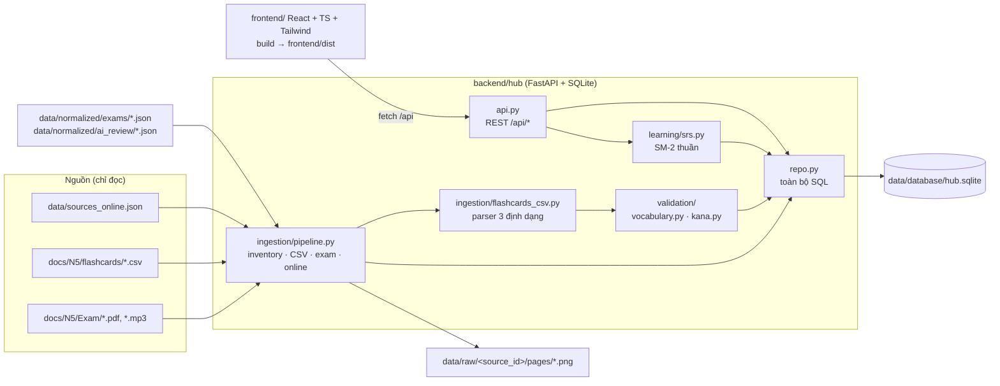
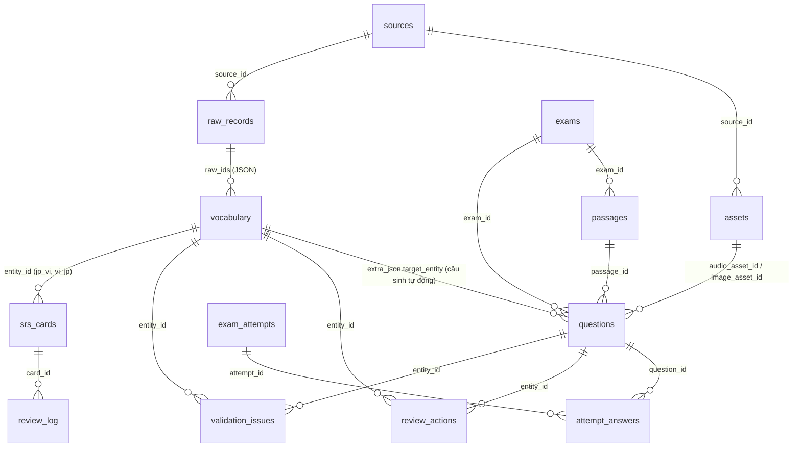
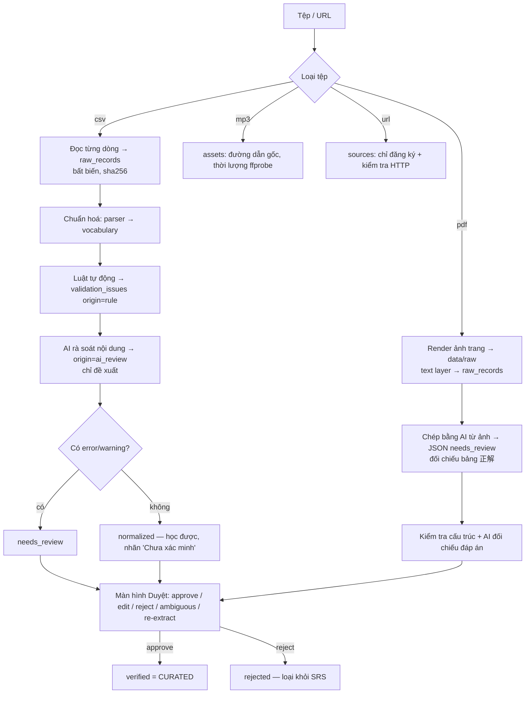
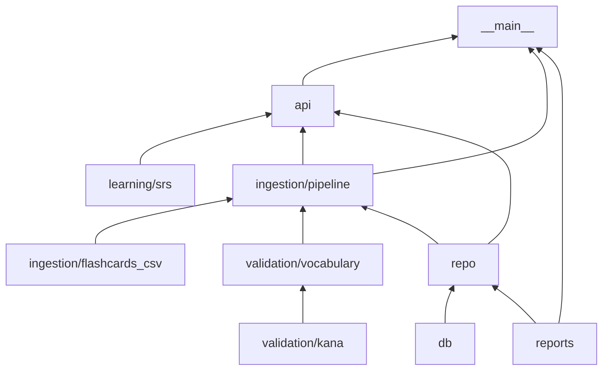

# ARCHITECTURE — Japanese N5 Learning Hub

Ứng dụng local-first cho 1 người học, chạy offline trên `http://127.0.0.1:8000`.

## 1. Kiến trúc tổng thể

## 2. ERD (rút gọn)

Chi tiết cột: xem `docs/DATA_DICTIONARY.md` và `backend/hub/db.py`.

## 3. Luồng dữ liệu & kiểm định

## 4. Phụ thuộc module

`learning/srs.py`, `validation/*` và `ingestion/flashcards_csv.py` là hàm thuần (không DB), kiểm thử độc lập.

## 5. Quyết định kiến trúc (ADR)

| # | Quyết định | Lý do | Hệ quả / nâng cấp |
|---|---|---|---|
| ADR-001 | FastAPI + SQLite + React/TS/Tailwind (đúng gợi ý spec Part 12) | Dự án greenfield; 1 người dùng; offline | Có thể chuyển PostgreSQL khi nhiều người dùng |
| ADR-002 | `sqlite3` chuẩn, SQL tập trung trong `repo.py`, không ORM | Ít phụ thuộc, dễ đọc; repository pattern vẫn tách UI/logic/DB | Migration hiện bằng `CREATE … IF NOT EXISTS`; thêm `PRAGMA user_version` khi đổi schema có dữ liệu |
| ADR-003 | Lớp RAW = bảng `raw_records` với trigger chặn UPDATE/DELETE | Ràng buộc ở DB, không phụ thuộc code | Sửa dữ liệu chỉ ở lớp NORMALIZED |
| ADR-004 | NORMALIZED vs CURATED phân biệt bằng `verification_status`; cột `verified_by` (`ai` / `user` / `pending_user`) ghi ai xác minh (sửa đổi ở phiên 2, xem ADR-013) | Tránh nhân bản bảng; một nguồn sự thật | "Curated bank" = `WHERE verification_status='verified'` |
| ADR-005 | Flashcard chưa xác minh vẫn học được, có nhãn | Quyết định của người dùng (phiên 1) | Ngân hàng câu sinh tự động chỉ dùng từ đã xác minh. Đề mẫu chính thức chờ đối chiếu ảnh vẫn thi được (đáp án đã khớp 正解), có nhãn "chờ đối chiếu ảnh gốc" |
| ADR-006 | Đề PDF có font CID hỏng → chép bằng AI từ ảnh trang, `needs_review`, đáp án lấy từ 正解 và bị kiểm tra chéo khi import | Không có text layer dùng được; không bịa | Người dùng đối chiếu ảnh gốc trên màn hình Duyệt |
| ADR-007 | ~~AI rà soát chỉ đề xuất, không sửa dữ liệu~~ — **thay bằng ADR-013** | Phiên 1 | — |
| ADR-008 | Website bên thứ ba: chỉ đăng ký + kiểm tra truy cập HTTP | Spec §2.2: không vượt rào, không thay câu hỏi bằng AI | Trích xuất từng site cần đánh giá điều khoản sử dụng trước |
| ADR-009 | Phát âm dùng Web Speech API, ghi rõ "giọng máy" | Không có audio gốc cho từ vựng | Không bao giờ gán nhãn audio gốc |
| ADR-010 | Điều hướng bằng hash, không thêm router | 5 trang; ít phụ thuộc | Thêm react-router khi cần route lồng nhau |
| ADR-011 | ID từ vựng `VOC_xxxxxx` cấp theo thứ tự import (tệp sắp xếp theo tên, dòng theo thứ tự); bản sửa chỉ áp khi `id`, `raw_word` (mặt trước CSV gốc) **và** `old_value` đều khớp | Ổn định khi import lại; an toàn nếu ID lệch | Thêm khoá nội dung nếu bổ sung nhiều nguồn mới |
| ADR-012 | Từ điển tham chiếu offline: JMdict + KANJIDIC2 (EDRDG, CC BY-SA 4.0) dựng thành `data/reference/reference.sqlite` (`python -m hub build-reference`, tự tải). Nhóm động từ lấy từ lớp chia động từ của thể từ điển; `HV_OVERRIDES` bổ sung các âm Hán-Việt mà KANJIDIC2 ghi sai (鶏 KÊ, 着 TRƯỚC, 晩 VÃN…) | Spec §6.1 cấm suy nhóm từ ます; Hán-Việt cần nguồn kiểm chứng | Tệp từ điển không commit (≈50 MB); thêm override chỉ khi chắc chắn |
| ADR-014 | OCR bằng Tesseract 5.4 (tessdata_best jpn/jpn_vert/vie, nằm trong `data/reference/tessdata`). Với bảng từ vựng: tìm vị trí đường kẻ cột, xoá đường kẻ, OCR từng cột theo ngôn ngữ của cột, rồi ghép hàng theo toạ độ dòng. Kết quả OCR là RAW (`ocr_tesseract_table`), không bao giờ được coi là đã xác minh | OCR cả trang bị đường kẻ bảng gây nhiễu nặng; cột kana/Việt chính xác hơn nhiều so với cột kanji | Chữ kanji OCR sai được khôi phục nhờ kana + Hán-Việt + JMdict, rồi qua rà soát AI |
| ADR-015 | Cơ sở kiến thức ngoài flashcard (từ vựng bổ sung, ngữ pháp, kanji) lưu thành file JSON có kiểm soát trong `data/normalized/`. Importer coi file là nguồn chuẩn (đồng bộ DB theo file, trừ mục người dùng đã quyết định). Độ phủ đo bằng khung tham chiếu: danh sách JLPT N5 (718 từ), danh sách kanji cấp 4 cũ (103 chữ), khung 135 điểm ngữ pháp theo Minna 1–25 | Có thể truy vết, rà soát, sửa lại; đo được "đủ N5" thay vì gom tài liệu vô hạn | Thêm N4 bằng cách thêm file và khung tham chiếu mới (cột `level`) |
| ADR-016 | Ngữ pháp: giữ giải thích đúng của cẩm nang người dùng (`origin=handbook+ai`), ghi lại từng chỗ cẩm nang sai trong `handbook_errors` (hiện trên UI). Điểm cẩm nang không có thì AI soạn mới (`origin=ai`). Điểm nằm ở ranh giới N5/N4 có `level_note`, vì JLPT không công bố danh sách ngữ pháp chính thức | Spec yêu cầu giữ giải thích gốc và phân biệt nội dung AI | — |
| ADR-013 | Theo yêu cầu người dùng (phiên 2), AI **được sửa** dữ liệu từ vựng, với điều kiện: 2 vòng rà soát độc lập, có bằng chứng từ điển, người duyệt cuối xét từng đề xuất, rồi ghi vào `data/normalized/corrections/vocabulary_corrections.json`. Khi áp: RAW không đổi, mỗi thay đổi ghi vào `review_actions` (`ai_correction`). Mục chỉ được `verified_by='ai'` khi đã audit và không còn lỗi/cảnh báo. Người dùng sửa hoặc duyệt thì luôn thắng (`pending_user`/`user` → automation không động vào) | Dữ liệu CSV do AI miễn phí tạo, nhiều lỗi; người dùng không muốn tự duyệt 963 mục | Có thể hoàn tác từng mục bằng "Trích xuất lại từ RAW" |

| ADR-017 | Câu hỏi luyện tập **sinh bằng luật** (`hub/learning/question_gen.py`), không phải do LLM viết: 漢字読み (bẫy âm đục, っ, trường âm, ゃゅょ chỉ trên phần đọc của kanji) và 表記 (thay 1 chữ bằng kanji N5 có đúng âm mà chữ đó mang trong từ, tách âm theo KANJIDIC2). Phương án nhiễu bị loại nếu trùng cách đọc JMdict hoặc là từ có thật. Câu nằm trong đề `BANK_N5_GENERATED` (`is_official=0`, `source_type=AI_GENERATED`), `verified_by='generator'`. ID ổn định (`Q_GEN_KR_/Q_GEN_OR_<VOC id>`). Câu không sinh lại được thì thành `rejected`, không xoá | Spec §11.5: câu AI phải có nhãn, đúng 1 đáp án, giải thích từng lựa chọn; sinh tất định từ dữ liệu đã xác minh thì kiểm chứng được bằng test | Mở rộng sang 文脈規定/言い換え/文法 cần câu do agent soạn + rà soát 2 vòng (phiên sau) |
| ADR-018 | Mock exam: một lượt thi (`exam_attempts`) **đóng băng** danh sách câu và thời gian từng phần lúc bắt đầu. Server là nguồn sự thật cho giờ (`section_started_at`) và khoá phần (chế độ thi chỉ trả lời được phần hiện tại; hết giờ +5 giây ân hạn → 409). Ở chế độ thi, payload không chứa đáp án, giải thích, script, `option_explanations`, `expected_sequence`; lựa chọn chỉ có trong audio bị xoá chữ | Spec §9.2, §10: không lộ đáp án khi thi; tải lại trang không mất bài | Một lượt chỉ có một người làm; chưa có đồng bộ nhiều thiết bị |
| ADR-019 | **Đề thi thật các năm** (thư mục Drive "ĐỀ THI" của người dùng) được nhập dù JLPT không công bố 正解: `exam_type='past_exam'`, `is_official=0`, `source_type=COMMUNITY_KEY` (có bảng đáp án cộng đồng: 参考答案/正答表/PDF Yuuki Bùi) hoặc `AI_ANSWERED`. Mỗi câu được 2 agent giải **độc lập** (A: giải + giải thích, B: giải từ ảnh trang + soát bản chép), không thấy key và không thấy nhau. `verified` (`verified_by='ai'`) chỉ khi key = A = B (`examlib.consensus_status`); lệch → `needs_review` + issue `answer_key_disputed`. Người dùng uỷ quyền (2026-11-15): khi lệch, chọn theo căn cứ chính xác nhất và giải thích được; quyết định ghi `decided_by: user` trong JSON đề → `verified_by='user'`, căn cứ ghi ở `docs/PAST_EXAMS.md`. Bản chép + kết quả AI chỉ lưu trên máy (`.gitignore`). Một importer chung `import_exam()` cho đề mẫu và đề thật; JSON khai báo `files`, `question_id_prefix`, `key_origin` | Người dùng yêu cầu có thêm đề thật để luyện (phiên 5), chấp nhận đáp án cộng đồng nếu được AI đối chiếu; spec §11.5 yêu cầu nhãn nguồn rõ | Đề là bản dựng lại/quét của cộng đồng nên có thể khác đề gốc ở chi tiết; câu nghe chưa có timestamp |
| ADR-020 | **Câu ngữ pháp do agent soạn** (`data/normalized/grammar_questions/grammar_questions.json`, đề `BANK_N5_GRAMMAR_AI`, `exam_type='question_bank'`, `source_type=AI_GENERATED`, `is_official=0`). Mỗi câu gắn `grammar_id` (điểm ngữ pháp verified), có giải thích từng lựa chọn; câu ★ có `star_position` + `expected_sequence`. `verified_by='ai'` chỉ khi: `audited`, không issue error/warning từ `check_grammar_question` (cấu trúc ô, ★ khớp thứ tự, kanji N5, không trùng đề thật), và 2 AI giải mù độc lập (không thấy key, chia lô khác lúc soạn) cùng chọn key (`examlib.consensus_status`). Câu sửa sau duyệt phải giải mù lại. Câu bị loại → `excluded: true` → `rejected`, không xoá. Không đặt `lesson_number` (tránh lẫn vào "từ vựng yếu"); kết quả thi gom theo `grammar_id` → `weak_grammar_points` | Grammar §7.3 cần bài tập; đề thật không đủ câu theo từng điểm ngữ pháp; luật thuần không sinh được câu ngữ pháp tự nhiên | Hai AI đồng ý không chứng minh tuyệt đối tính duy nhất của đáp án; người dùng có thể sửa/loại qua file |
| ADR-021 | **SRS đa loại**: ngữ pháp + kanji dùng chung bảng `srs_cards` và thuật toán SM-2 với từ vựng (`entity_type` = vocabulary/grammar/kanji). Ngữ pháp/kanji chỉ 1 chiều (mẫu/chữ → nghĩa), lưu `direction='jp_vi'`. Hạn mức thẻ mới/ngày tính riêng từng loại. `ensure_cards` chạy sau khi nhập ngữ pháp/kanji; mục `rejected` không có thẻ. Số liệu từ vựng trên Dashboard lọc `entity_type='vocabulary'`. **Gợi ý ngữ pháp cần ôn** = câu trả lời mới nhất của mỗi câu hỏi trong các lượt đã nộp (`repo.latest_answers`, dùng chung với Mode E), gom theo `grammar_id` bằng `examlib.score` → làm đúng lại thì điểm đó rơi khỏi danh sách. Thứ tự hoà cùng giây phá bằng `rowid` | Spec §8 SRS cho mọi loại kiến thức; Dashboard §13 cần gợi ý học | Không có chiều Việt→Nhật cho ngữ pháp/kanji; gợi ý chỉ dựa trên câu có `grammar_id` (ngân hàng ADR-020), đề thật chưa gắn điểm ngữ pháp |
| ADR-022 | **Mục tiêu ngày, gợi ý học, thống kê** (spec §13, §14). *Hoạt động học* = lượt ôn thẻ SRS (`review_log`) + câu trả lời trong thi/luyện tập (`attempt_answers.answered_at`), gộp ở `repo.ACTIVITY_SQL`; streak và tiến độ mục tiêu ngày (`settings.daily_goal`) tính trên tập này. **Thời gian học là ước tính**: `analytics.active_seconds` cộng khoảng cách giữa hai lần trả lời liên tiếp nếu ≤ 5 phút (dài hơn = phiên mới). **Gợi ý** (`analytics.recommend`, hàm thuần) theo thứ tự: thẻ đến hạn → câu sai chờ ôn (Mode E) → điểm ngữ pháp yếu nhất (luyện theo `grammar_id`) → chưa nộp lượt thi trong 7 ngày → thẻ mới (khi không có thẻ đến hạn); không có dữ liệu thì không gợi ý. `GET /api/stats/analytics`: hoạt động 30 ngày, tỉ lệ nhớ SRS theo loại, xu hướng theo lượt thi, độ chính xác theo phần/mondai (lần trả lời gần nhất), câu sai ≥ 2 lần. `AttemptStart.grammar_id` lọc câu theo 1 điểm ngữ pháp (`json_extract(extra_json,'$.grammar_id')`). Các truy vấn "lượt gần nhất" phá hoà cùng giây bằng `rowid` | Dashboard §13 cần mục tiêu ngày + hoạt động gợi ý; §14 cần thời gian học, xu hướng, câu sai lặp lại, gợi ý dựa trên dữ liệu thật | Không đo thời gian đọc trước câu đầu mỗi phiên (ước tính thấp hơn thực tế); đọc hiểu/nghe tách riêng chỉ theo phần thi, chưa theo kỹ năng con |
| ADR-023 | **Hội thoại Kaiwa** (spec §7.4; `data/normalized/kaiwa/kaiwa.json`, bảng `kaiwa`, trang Hội thoại). 9 chủ đề × 3 bài, mỗi lượt lời có `speaker`, `jp`, `hiragana`, `vi`; bài tham chiếu `vocab` (chữ hoặc cách đọc của từ vựng verified, resolve thành VOC id lúc nhập) và `grammar_ids` (điểm verified). `check_kaiwa`: lỗi khi thiếu trường / chủ đề sai / từ hoặc điểm ngữ pháp không verified / từ không xuất hiện trong câu (động từ ます so bằng gốc); cảnh báo khi dòng đọc có ký tự không phải kana, kana của câu không xuất hiện theo thứ tự trong dòng đọc, cách đọc của từ tham chiếu không có trong dòng đọc; kanji ngoài N5 chỉ là `info`. `verified_by='ai'` khi `audited` (sau 2 vòng rà soát AI độc lập chia lô khác nhau + người duyệt cuối, bằng chứng `ai_review/kaiwa_review.json`) và không có error/warning. Không có audio gốc: phát bằng giọng máy trình duyệt (có nhãn). **Không bao giờ vào ngân hàng câu/đề thi** (test) | Spec §7.4 yêu cầu module hội thoại bổ trợ; dữ liệu học đã đủ nên soạn từ chính từ vựng/ngữ pháp verified | AI soạn: tự nhiên nhưng có thể còn sót lỗi tinh tế; chưa có màn Duyệt riêng cho hội thoại (sửa qua file + `review_log`) |
| ADR-024 | **Sao lưu / khôi phục qua UI**: `GET /api/backup` = `sqlite3.backup` sang file tạm, tải về `n5hub-backup-<thời gian>.sqlite`. `POST /api/restore` nhận **thân request thô** (không cần python-multipart): kiểm header SQLite, `PRAGMA integrity_check`, có đủ bảng `vocabulary, srs_cards, review_log, exam_attempts`; hợp lệ thì **tự sao lưu DB hiện tại** vào `<thư mục DB>/backups/pre-restore-*.sqlite` rồi `backup()` đè vào kết nối đang mở và chạy `db.migrate()` (bản cũ có thêm bảng/cột mới). Panel ở Dashboard | Spec §15: export/import backup, khôi phục tiến độ | Khôi phục cả DB (gồm nội dung học): bản cũ cần chạy `hub import` để lấy nội dung mới; không hợp nhất 2 bản |
| ADR-025 | **Mốc thời gian từng câu nghe** (`backend/scripts/listening_timestamps.py` → `data/normalized/exams/listening_timestamps.json`, chỉ có `question_id` + giây, không chứa nội dung đề nên được commit). ASR Whisper `large-v3-turbo` (đoạn có start/end, lưu cục bộ ở `data/raw/PAST_EXAM_WORK/asr/`) được căn với script giấy của từng câu: chuẩn hoá (chỉ kana/kanji, katakana→hiragana, bỏ nhãn người nói), tìm đoạn khớp nhất với ~40 ký tự đầu transcript (difflib) theo thứ tự đề; không thấy thì tìm trong cả mondai (đề in có thể đảo thứ tự so với audio, ví dụ 2021-12 問題2 4番/6番). Đầu câu = mốc 「N番」 ngay trước (nếu có); cuối câu = đầu câu kế tiếp hoặc đoạn 「問題N」 kế tiếp. Chỉ ghi mốc khi: độ khớp đầu ≥ 0,5, độ dài 5–150 s, độ phủ transcript trong cửa sổ ≥ 0,45 (hoặc khớp đầu ≥ 0,65 khi ASR viết kana thay kanji). Importer ghi `audio_start`/`audio_end` vào `extra_json` (công khai cả ở chế độ thi, không lộ đáp án); câu có mốc không còn issue `audio_timestamp_missing`. UI: nút "▶ Nghe câu này" tua đến đầu câu và tự dừng ở cuối câu | Đề có 1 track cho cả phần nghe; người học phải tự tua | Căn tự động có thể lệch 1–2 s; đề mẫu chính thức: MP3 chỉ có 4/8 câu nên 4 câu còn lại không có mốc |
| ADR-026 | **Ngân hàng bài đọc do agent soạn** (`data/normalized/reading_questions/reading_questions.json`, đề `BANK_N5_READING_AI`, `question_bank`, `AI_GENERATED`, `is_official=0`): 文章の文法 (mondai 3), 読解 短文/中文/情報検索 (mondai 4/5/6). Mỗi mục là **1 bài đọc** (`passages`), câu hỏi có `passage_id` + `number` = thứ tự trong bài; 文章の文法 dùng chỗ trống `［k］` trong bài, `question_text` = `［k］`. Luật `check_reading_group`: số chỗ trống khớp số câu, đọc hiểu không có chỗ trống, 4 lựa chọn/đáp án/giải thích, `grammar_id` (nếu có) phải verified, kanji ngoài N5 = warning, trùng bài đọc của đề thật = error. Cùng điều kiện verified như ADR-020 (`_upsert_bank_question` dùng chung): `audited` + không error/warning + key = 2 AI giải mù (lượt A chia theo loại bài, lượt B chẵn/lẻ; bằng chứng `ai_review/reading_questions_review.json`). Sửa bài → giải mù lại các câu của bài đó. Bản dịch bài (`passage_translation_vi`) chỉ hiện sau khi trả lời. Lấy mẫu luyện tập **theo nhóm bài đọc** (không cắt rời bài, xếp theo `passage_id` rồi `number`) | Ngân hàng luyện tập chưa có mondai 3–6, chỉ đề thật mới có | AI soạn: tự nhiên nhưng là bài luyện, không phải đề JLPT; 情報検索 là bảng dạng chữ (không có hình); số câu lấy ra có thể vượt `limit` vài câu để giữ trọn bài |
| ADR-027 | **Flashcard: hạn mức 500 thẻ mới/ngày, lọc khoảng bài, xáo trộn, chế độ "Ôn tổng hợp"**. `GET /api/srs/due`: `new_limit` ≤ 500 (trước 200), lấy tối đa 1000 thẻ đến hạn mỗi lần (trước 100), `lesson_from`/`lesson_to` (BETWEEN; bỏ qua với kanji; đặt khoảng thì loại từ bổ sung không có số bài), `shuffle` (thẻ mới chọn bằng `RANDOM()`, client xáo cả hàng đợi). `GET /api/srs/cram?source=studied|weak|all&n` (`repo.cram_cards`, chỉ đọc): thẻ đã học / thẻ có `incorrect_count>0` (quên nhiều trước) / tất cả, ngẫu nhiên. UI Ôn tổng hợp chỉ có 2 nút: **Quên** gọi `/answer` với `again` (thẻ quay lại lịch SRS), **Nhớ** với thẻ chưa học (`status='new'`, chưa có lịch để làm lệch) = lượt ôn thật `good` (vào SRS, tính vào Tổng quan/hạn mức thẻ mới); với thẻ đã học thì không chấm SM-2, chỉ gọi `POST /api/srs/cards/{id}/recalled` ghi `weak_cleared_at` → nguồn "weak" loại thẻ có `weak_cleared_at` ≥ lần `again` gần nhất (thẻ quay lại khi bị Quên tiếp; trước đây "weak" không bao giờ ngắn đi) | Người dùng học từ vựng chủ yếu bằng lật thẻ; trước thi cần lật ngẫu nhiên từ đã học thay vì chỉ thẻ đến hạn theo thứ tự bài | Chấm "Được" cho thẻ chưa đến hạn làm SM-2 giãn khoảng cách sai, nên lượt "Nhớ" không vào `review_log` → không tính vào mục tiêu ngày/thời gian học (ADR-022); "Quên" ở nguồn "Tất cả" với thẻ chưa học sẽ tính vào hạn mức thẻ mới hôm nay |
| ADR-028 | **Ôn ngữ pháp gom nhiều bài**. `AttemptStart.lesson_from`/`lesson_to` (1–26, cần cả hai, from ≤ to; **26 = điểm N5 bổ sung** không có số bài, nên "25 + N5 bổ sung" là chọn 1–26). `repo.questions_where(grammar_lessons=(lo, hi))` lọc câu có `grammar_id` thuộc điểm có `COALESCE(lesson_number, 26) BETWEEN lo AND hi`, **chỉ câu không thuộc bài đọc** (`passage_id IS NULL`) → thực tế là câu 文の文法1/2 của ADR-020. Dùng lại luồng luyện tập có sẵn (lấy mẫu ngẫu nhiên, `limit`, hiện đáp án ngay, tính vào thống kê và "Ngữ pháp cần ôn"). Khi đã hiện đáp án, câu có `grammar_id` hiện thêm ý nghĩa + cấu trúc của điểm (`GrammarHint` gọi `/api/grammar/{id}`) và link sang trang điểm đó. UI: panel "Ôn nhanh nhiều bài" ở trang Ngữ pháp | Người dùng thấy luyện từng điểm quá chậm, muốn vừa học vừa ôn nhiều bài trong một lượt | Không gồm 文章の文法 (phải kéo theo cả bài đọc); không gắn với lịch SRS ngữ pháp |
| ADR-029 | **Chuyên đề Số đếm & ngày tháng** (`data/normalized/numbers/numbers.json` → bảng `number_categories` + `numbers`, trang Số đếm). 23 nhóm đúng phạm vi N5: số (百/千/万), ～つ ～人 ～枚 ～本 ～匹 ～杯 ～冊 ～台 ～個 ～回 ～階 ～歳, giờ/phút/～時間, thứ, ngày, tháng, năm, ～週間, ～か月, ～円. Cách đọc gõ tay, kiểm bằng **luật biến âm độc lập** `validation/numbers.py` (`expected_readings`: âm ngắt 1/6/8/10/100 theo lớp k/s/h của trợ số từ, h→p/b, 階 さんがい, 分 さんぷん/よんぷん, 4/7/9 theo trợ số từ, bảng từ vựng hoá ひとつ/ついたち/はたち…) + JMdict + 2 vòng rà soát AI (A theo nhóm, B chẵn/lẻ) + người duyệt cuối (`ai_review/numbers_review.json`). `verified_by='ai'` khi `audited` và không lỗi/cảnh báo. **SRS** loại `number`, 1 chiều, chỉ mục `irregular=1` (dạng cần nhớ riêng). **Trắc nghiệm 漢字読み** trong đề `BANK_N5_NUMBERS` (`question_bank`, `AI_GENERATED`, `verified_by='generator'`, id `Q_NUM_<NHÓM>_<số>`): phương án nhiễu = cách ghép thẳng (`naive_readings`: はちにち, よんじ), biến âm sai ở âm đầu trợ số từ, đổi cách đọc số đầu từ, bỏ っ; với danh sách học thuộc (～つ, ngày, thứ, ～人 1–2) dùng cách đọc của mục đặc biệt khác; mọi phương án nhiễu nằm ngoài tập đúng (luật ∪ JMdict ∪ mục) — có test. Câu không đủ bẫy thật (≥2, hoặc ≥1 với mục đặc biệt) thì không sinh. `AttemptStart.topic='numbers'` để luyện riêng | Người dùng chưa vững số đếm/ngày tháng; deck CSV Số Đếm chỉ 16 thẻ hỏi–đáp (RAW), thiếu các biến âm; JLPT 漢字読み hay hỏi 三本/八日/九時 | Mục có hai cách đọc đều đúng (三階 さんがい/さんかい, 七時 しちじ/ななじ) không ra câu hỏi; ví dụ là câu mẫu theo khuôn từng nhóm |
| ADR-030 | **SRS cấp tốc**. Chế độ thứ 3 ở trang Flashcard, dùng chung `srs_cards`, áp cho mọi loại thẻ. `srs.schedule(..., intensive=True, exam_date)`: bậc `INTENSIVE_STEPS` 10 phút → 1 → 2 → 4 → 7 ngày theo `reps` (`good` +0, `easy` +1, `hard` −1 bậc); nếu `exam_date` còn ≥ 2 ngày thì khoảng ≤ (ngày thi − hôm nay − 1); `again` như SM-2. `classify(intensive=True)`: `mastered` khi `reps ≥ 5`. `GET /api/srs/due?intensive=true`: đến hạn khi `due_at ≤ now` **hoặc** `last_studied ≤ now − srs.intensive_gap(reps)` (bậc của chuỗi nhớ hiện tại: reps 1 → 10 phút, 2 → 1 ngày, 3 → 2, 4 → 4, ≥5 → 7; tính khi đọc, không sửa `due_at`). Nhờ vậy thẻ SM-2 thường hẹn xa (6–8 ngày) cũng theo bậc cấp tốc. Phiên 14b: bản đầu chỉ kéo thẻ không gặp 7 ngày → 534 thẻ học theo lịch thường bị bỏ sót; đã sửa, đồng thời bỏ quy tắc giữ khoảng SM-2 cũ để lịch khi chấm = lịch khi đọc. `POST /answer?intensive=true` đọc setting `exam_date` (`PUT /api/settings` nay cập nhật từng phần). UI đưa thẻ có `due_at` trong 20 phút về cuối hàng đợi (thay quy tắc "chỉ thẻ again") | Người dùng thi sau ~17 ngày với hơn 1000 từ: SM-2 cần khoảng ≥ 21 ngày mới "thuộc" nên không thể đạt trước kỳ thi, và nhiều thẻ bị hẹn sau ngày thi | Khoảng 1000 từ × 5–6 lượt trong 17 ngày ≈ 300–400 lượt/ngày. Thẻ trộn hai chế độ: lượt chấm sau quyết định trạng thái (thẻ "thuộc" cấp tốc có thể về "đang ôn" khi chấm ở SRS thường) |
| ADR-031 | **Số đếm: thêm câu 表記 + luyện theo nhóm**. `question_gen.number_orthography_question`: cho cách đọc (trong câu ví dụ, từ được thay bằng kana), chọn cách viết. Phương án nhiễu = cách viết khác trong chuyên đề số đếm mà **không** đọc được như đề (tập đọc hợp lệ = `number_valid_readings` hợp lại cho mọi mục cùng cách viết), lấy 3 phương án gần âm nhất (khoảng cách chỉnh sửa), hoà thì ưu tiên chung chữ (八日/四日, 三本/三杯). Id `Q_NUM_<NHÓM>_<số>_OR`, `mondai_type=orthography`, cùng đề `BANK_N5_NUMBERS`; `extra_json.category` gắn cho cả 2 dạng. `AttemptStart.number_categories` (lọc `json_extract(extra_json,'$.category')`), `limit` ≤ 500. Trang Số đếm: chọn nhóm, dạng (Đọc/Viết/cả hai), số câu (10/20/50/100/tất cả) | Người dùng yếu số đếm/ngày tháng, thấy 1 lượt 20 câu chỉ 1 dạng là ít, muốn ôn theo nhóm tuỳ chọn | 419 câu (147 đọc + 272 viết). Câu số đơn (こたえは いちです) dễ nhưng vẫn đúng, giữ lại |

## 6. Thời gian & điểm thi
- Đề lịch sử giữ thời gian gốc (`duration_minutes`; đề mẫu = null → không giới hạn). Người học có thể chọn "tính giờ theo JLPT hiện hành" (20/40/30 phút): thời gian chỉ áp vào lượt thi (`config_json`), không sửa metadata của đề.
- Lượt tổ hợp từ ngân hàng: không giờ, theo JLPT (20/40/30 mỗi phần), hoặc tự đặt (chia theo số câu từng phần). Chế độ luyện tập không tính giờ.
- Điểm (`hub/learning/exam.py`): **kết quả luyện tập** (đúng/sai/chưa làm/%, theo phần, theo mondai, độ chính xác nghe, bài từ vựng yếu) tách riêng khỏi **ước lượng sẵn sàng** (quy tỉ lệ đúng ra thang 120/60, so ngưỡng 80/38/19, ghi rõ "không phải điểm JLPT chính thức"; phần nào không có trong lượt thì để trống).
