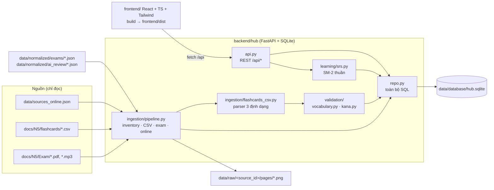
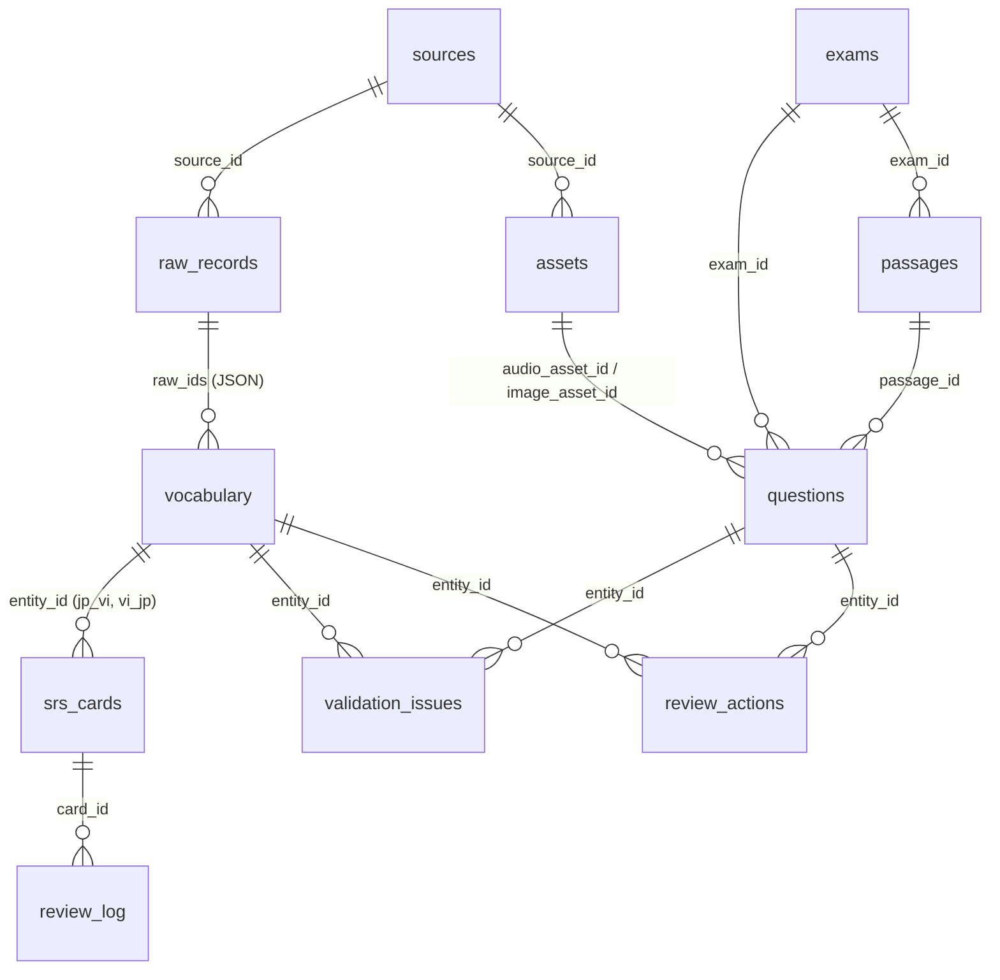
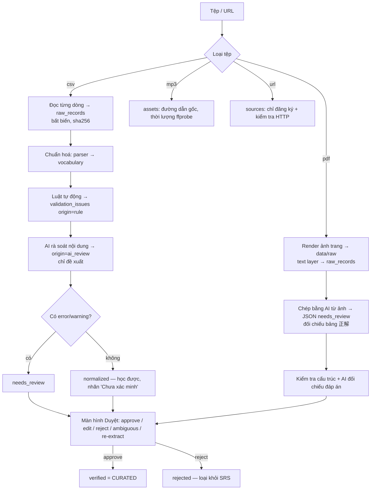
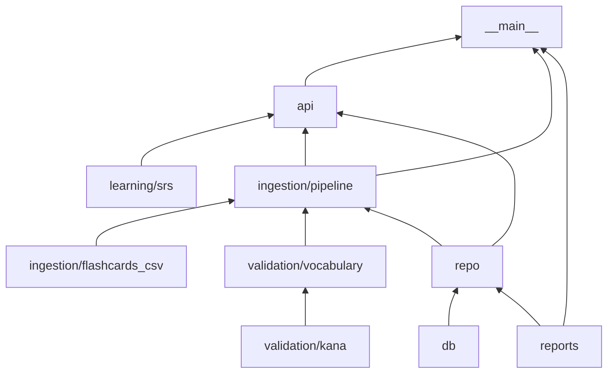

# ARCHITECTURE — Japanese N5 Learning Hub

Ứng dụng local-first cho 1 người học, chạy offline trên `http://127.0.0.1:8000`.

## 1. Kiến trúc tổng thể

## 2. ERD (rút gọn)

Chi tiết cột: xem `docs/DATA_DICTIONARY.md` và `backend/hub/db.py`.

## 3. Luồng dữ liệu & kiểm định

## 4. Phụ thuộc module

`learning/srs.py`, `validation/*` và `ingestion/flashcards_csv.py` là hàm thuần (không DB), kiểm thử độc lập.

## 5. Quyết định kiến trúc (ADR)

| # | Quyết định | Lý do | Hệ quả / nâng cấp |
|---|---|---|---|
| ADR-001 | FastAPI + SQLite + React/TS/Tailwind (đúng gợi ý spec Part 12) | Dự án greenfield; 1 người dùng; offline | Có thể chuyển PostgreSQL khi nhiều người dùng |
| ADR-002 | `sqlite3` chuẩn, SQL tập trung trong `repo.py`, không ORM | Ít phụ thuộc, dễ đọc; repository pattern vẫn tách UI/logic/DB | Migration hiện bằng `CREATE … IF NOT EXISTS`; thêm `PRAGMA user_version` khi đổi schema có dữ liệu |
| ADR-003 | Lớp RAW = bảng `raw_records` với trigger chặn UPDATE/DELETE | Ràng buộc ở DB, không phụ thuộc code | Sửa dữ liệu chỉ ở lớp NORMALIZED |
| ADR-004 | NORMALIZED vs CURATED phân biệt bằng `verification_status`; chỉ API Review (người dùng) đặt `verified` | Tránh nhân bản bảng; một nguồn sự thật | "Curated bank" = `WHERE verification_status='verified'` |
| ADR-005 | Flashcard chưa xác minh vẫn học được, có nhãn | Quyết định của người dùng (phiên 1) | Đề thi chỉ dùng câu đã xác minh |
| ADR-006 | Đề PDF có font CID hỏng → chép bằng AI từ ảnh trang, `needs_review`, đáp án lấy từ 正解 và bị kiểm tra chéo khi import | Không có text layer dùng được; không bịa | Người dùng đối chiếu ảnh gốc trên màn hình Duyệt |
| ADR-007 | AI rà soát chỉ tạo `validation_issues` (origin=ai_review) + `suggestion`, không sửa dữ liệu | Spec §11.5: phân biệt nội dung AI và dữ liệu đã xác minh | Người dùng bấm "Điền gợi ý" rồi Duyệt |
| ADR-008 | Website bên thứ ba: chỉ đăng ký + kiểm tra truy cập HTTP | Spec §2.2: không vượt rào, không thay câu hỏi bằng AI | Trích xuất từng site cần đánh giá điều khoản sử dụng trước |
| ADR-009 | Phát âm dùng Web Speech API, ghi rõ "giọng máy" | Không có audio gốc cho từ vựng | Không bao giờ gán nhãn audio gốc |
| ADR-010 | Điều hướng bằng hash, không thêm router | 5 trang; ít phụ thuộc | Thêm react-router khi cần route lồng nhau |
| ADR-011 | ID từ vựng `VOC_xxxxxx` cấp theo thứ tự import (tệp sắp xếp theo tên, dòng theo thứ tự); file AI review chỉ áp khi `id` **và** `word` khớp | Ổn định khi import lại; an toàn nếu ID lệch | Thêm khoá nội dung nếu bổ sung nhiều nguồn mới |

## 6. Thời gian & điểm thi
- Thời gian đề hiện hành (20/40/30 phút) sẽ dùng cho đề mock; đề mẫu chính thức giữ `duration_minutes = null` vì tài liệu gốc không ghi.
- Điểm: sẽ tách "kết quả luyện tập" (đúng/sai/%) và "ước lượng sẵn sàng" có nhãn rõ — chưa triển khai (phiên sau).
