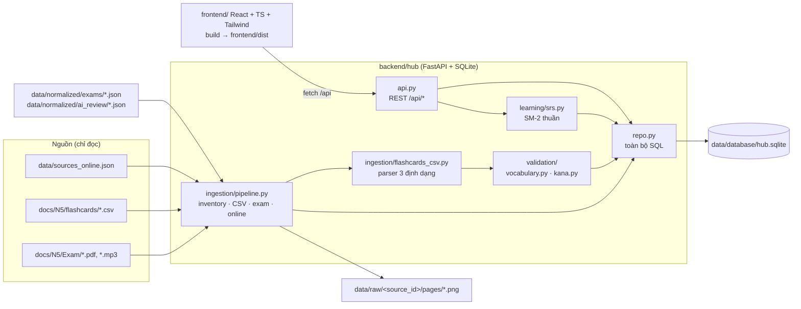
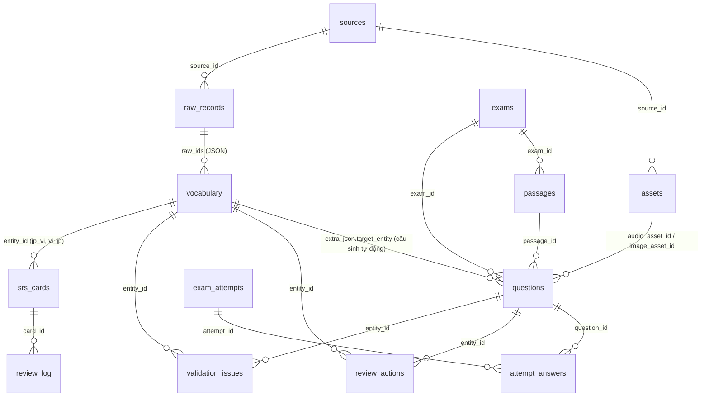
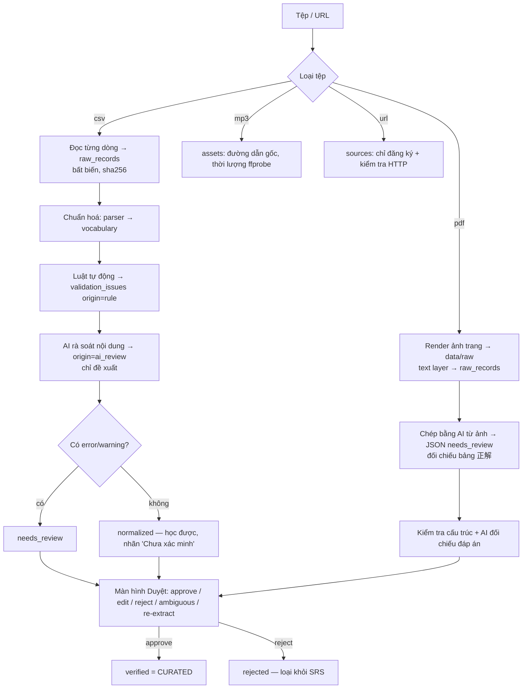
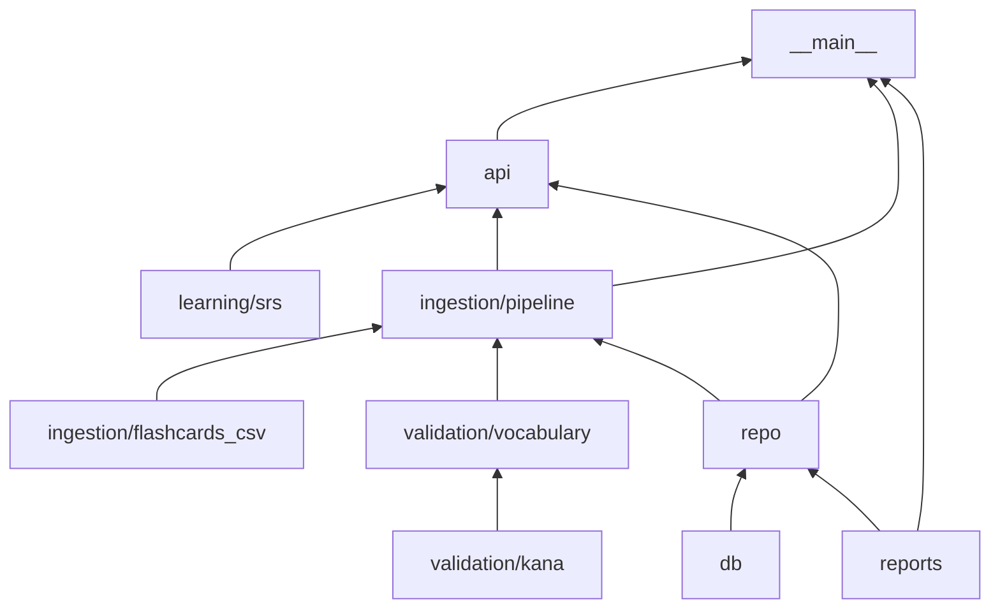

# ARCHITECTURE — Japanese N5 Learning Hub

Ứng dụng local-first cho 1 người học, chạy offline trên `http://127.0.0.1:8000`.

## 1. Kiến trúc tổng thể

## 2. ERD (rút gọn)

Chi tiết cột: xem `docs/DATA_DICTIONARY.md` và `backend/hub/db.py`.

## 3. Luồng dữ liệu & kiểm định

## 4. Phụ thuộc module

`learning/srs.py`, `validation/*` và `ingestion/flashcards_csv.py` là hàm thuần (không DB), kiểm thử độc lập.

## 5. Quyết định kiến trúc (ADR)

| # | Quyết định | Lý do | Hệ quả / nâng cấp |
|---|---|---|---|
| ADR-001 | FastAPI + SQLite + React/TS/Tailwind (đúng gợi ý spec Part 12) | Dự án greenfield; 1 người dùng; offline | Có thể chuyển PostgreSQL khi nhiều người dùng |
| ADR-002 | `sqlite3` chuẩn, SQL tập trung trong `repo.py`, không ORM | Ít phụ thuộc, dễ đọc; repository pattern vẫn tách UI/logic/DB | Migration hiện bằng `CREATE … IF NOT EXISTS`; thêm `PRAGMA user_version` khi đổi schema có dữ liệu |
| ADR-003 | Lớp RAW = bảng `raw_records` với trigger chặn UPDATE/DELETE | Ràng buộc ở DB, không phụ thuộc code | Sửa dữ liệu chỉ ở lớp NORMALIZED |
| ADR-004 | NORMALIZED vs CURATED phân biệt bằng `verification_status`; cột `verified_by` (`ai` / `user` / `pending_user`) ghi ai xác minh (sửa đổi ở phiên 2, xem ADR-013) | Tránh nhân bản bảng; một nguồn sự thật | "Curated bank" = `WHERE verification_status='verified'` |
| ADR-005 | Flashcard chưa xác minh vẫn học được, có nhãn | Quyết định của người dùng (phiên 1) | Ngân hàng câu sinh tự động chỉ dùng từ đã xác minh. Đề mẫu chính thức chờ đối chiếu ảnh vẫn thi được (đáp án đã khớp 正解), có nhãn "chờ đối chiếu ảnh gốc" |
| ADR-006 | Đề PDF có font CID hỏng → chép bằng AI từ ảnh trang, `needs_review`, đáp án lấy từ 正解 và bị kiểm tra chéo khi import | Không có text layer dùng được; không bịa | Người dùng đối chiếu ảnh gốc trên màn hình Duyệt |
| ADR-007 | ~~AI rà soát chỉ đề xuất, không sửa dữ liệu~~ — **thay bằng ADR-013** | Phiên 1 | — |
| ADR-008 | Website bên thứ ba: chỉ đăng ký + kiểm tra truy cập HTTP | Spec §2.2: không vượt rào, không thay câu hỏi bằng AI | Trích xuất từng site cần đánh giá điều khoản sử dụng trước |
| ADR-009 | Phát âm dùng Web Speech API, ghi rõ "giọng máy" | Không có audio gốc cho từ vựng | Không bao giờ gán nhãn audio gốc |
| ADR-010 | Điều hướng bằng hash, không thêm router | 5 trang; ít phụ thuộc | Thêm react-router khi cần route lồng nhau |
| ADR-011 | ID từ vựng `VOC_xxxxxx` cấp theo thứ tự import (tệp sắp xếp theo tên, dòng theo thứ tự); bản sửa chỉ áp khi `id`, `raw_word` (mặt trước CSV gốc) **và** `old_value` đều khớp | Ổn định khi import lại; an toàn nếu ID lệch | Thêm khoá nội dung nếu bổ sung nhiều nguồn mới |
| ADR-012 | Từ điển tham chiếu offline: JMdict + KANJIDIC2 (EDRDG, CC BY-SA 4.0) dựng thành `data/reference/reference.sqlite` (`python -m hub build-reference`, tự tải). Nhóm động từ lấy từ lớp chia động từ của thể từ điển; `HV_OVERRIDES` bổ sung các âm Hán-Việt mà KANJIDIC2 ghi sai (鶏 KÊ, 着 TRƯỚC, 晩 VÃN…) | Spec §6.1 cấm suy nhóm từ ます; Hán-Việt cần nguồn kiểm chứng | Tệp từ điển không commit (≈50 MB); thêm override chỉ khi chắc chắn |
| ADR-014 | OCR bằng Tesseract 5.4 (tessdata_best jpn/jpn_vert/vie, nằm trong `data/reference/tessdata`). Với bảng từ vựng: tìm vị trí đường kẻ cột, xoá đường kẻ, OCR từng cột theo ngôn ngữ của cột, rồi ghép hàng theo toạ độ dòng. Kết quả OCR là RAW (`ocr_tesseract_table`), không bao giờ được coi là đã xác minh | OCR cả trang bị đường kẻ bảng gây nhiễu nặng; cột kana/Việt chính xác hơn nhiều so với cột kanji | Chữ kanji OCR sai được khôi phục nhờ kana + Hán-Việt + JMdict, rồi qua rà soát AI |
| ADR-015 | Cơ sở kiến thức ngoài flashcard (từ vựng bổ sung, ngữ pháp, kanji) lưu thành file JSON có kiểm soát trong `data/normalized/`. Importer coi file là nguồn chuẩn (đồng bộ DB theo file, trừ mục người dùng đã quyết định). Độ phủ đo bằng khung tham chiếu: danh sách JLPT N5 (718 từ), danh sách kanji cấp 4 cũ (103 chữ), khung 135 điểm ngữ pháp theo Minna 1–25 | Có thể truy vết, rà soát, sửa lại; đo được "đủ N5" thay vì gom tài liệu vô hạn | Thêm N4 bằng cách thêm file và khung tham chiếu mới (cột `level`) |
| ADR-016 | Ngữ pháp: giữ giải thích đúng của cẩm nang người dùng (`origin=handbook+ai`), ghi lại từng chỗ cẩm nang sai trong `handbook_errors` (hiện trên UI). Điểm cẩm nang không có thì AI soạn mới (`origin=ai`). Điểm nằm ở ranh giới N5/N4 có `level_note`, vì JLPT không công bố danh sách ngữ pháp chính thức | Spec yêu cầu giữ giải thích gốc và phân biệt nội dung AI | — |
| ADR-013 | Theo yêu cầu người dùng (phiên 2), AI **được sửa** dữ liệu từ vựng, với điều kiện: 2 vòng rà soát độc lập, có bằng chứng từ điển, người duyệt cuối xét từng đề xuất, rồi ghi vào `data/normalized/corrections/vocabulary_corrections.json`. Khi áp: RAW không đổi, mỗi thay đổi ghi vào `review_actions` (`ai_correction`). Mục chỉ được `verified_by='ai'` khi đã audit và không còn lỗi/cảnh báo. Người dùng sửa hoặc duyệt thì luôn thắng (`pending_user`/`user` → automation không động vào) | Dữ liệu CSV do AI miễn phí tạo, nhiều lỗi; người dùng không muốn tự duyệt 963 mục | Có thể hoàn tác từng mục bằng "Trích xuất lại từ RAW" |

| ADR-017 | Câu hỏi luyện tập **sinh bằng luật** (`hub/learning/question_gen.py`), không phải do LLM viết: 漢字読み (bẫy âm đục, っ, trường âm, ゃゅょ chỉ trên phần đọc của kanji) và 表記 (thay 1 chữ bằng kanji N5 có đúng âm mà chữ đó mang trong từ, tách âm theo KANJIDIC2). Phương án nhiễu bị loại nếu trùng cách đọc JMdict hoặc là từ có thật. Câu nằm trong đề `BANK_N5_GENERATED` (`is_official=0`, `source_type=AI_GENERATED`), `verified_by='generator'`. ID ổn định (`Q_GEN_KR_/Q_GEN_OR_<VOC id>`). Câu không sinh lại được thì thành `rejected`, không xoá | Spec §11.5: câu AI phải có nhãn, đúng 1 đáp án, giải thích từng lựa chọn; sinh tất định từ dữ liệu đã xác minh thì kiểm chứng được bằng test | Mở rộng sang 文脈規定/言い換え/文法 cần câu do agent soạn + rà soát 2 vòng (phiên sau) |
| ADR-018 | Mock exam: một lượt thi (`exam_attempts`) **đóng băng** danh sách câu và thời gian từng phần lúc bắt đầu. Server là nguồn sự thật cho giờ (`section_started_at`) và khoá phần (chế độ thi chỉ trả lời được phần hiện tại; hết giờ +5 giây ân hạn → 409). Ở chế độ thi, payload không chứa đáp án, giải thích, script, `option_explanations`, `expected_sequence`; lựa chọn chỉ có trong audio bị xoá chữ | Spec §9.2, §10: không lộ đáp án khi thi; tải lại trang không mất bài | Một lượt chỉ có một người làm; chưa có đồng bộ nhiều thiết bị |
| ADR-019 | **Đề thi thật các năm** (thư mục Drive "ĐỀ THI" của người dùng) được nhập dù JLPT không công bố 正解: `exam_type='past_exam'`, `is_official=0`, `source_type=COMMUNITY_KEY` (có bảng đáp án cộng đồng: 参考答案/正答表/PDF Yuuki Bùi) hoặc `AI_ANSWERED`. Mỗi câu được 2 agent giải **độc lập** (A: giải + giải thích, B: giải từ ảnh trang + soát bản chép), không thấy key và không thấy nhau. `verified` (`verified_by='ai'`) chỉ khi key = A = B (`examlib.consensus_status`); lệch → `needs_review` + issue `answer_key_disputed`, người duyệt cuối quyết định, không tự đổi key. Bản chép + kết quả AI chỉ lưu trên máy (`.gitignore`). Một importer chung `import_exam()` cho đề mẫu và đề thật; JSON khai báo `files`, `question_id_prefix`, `key_origin` | Người dùng yêu cầu có thêm đề thật để luyện (phiên 5), chấp nhận đáp án cộng đồng nếu được AI đối chiếu; spec §11.5 yêu cầu nhãn nguồn rõ | Đề là bản dựng lại/quét của cộng đồng nên có thể khác đề gốc ở chi tiết; câu nghe chưa có timestamp |

## 6. Thời gian & điểm thi
- Đề lịch sử giữ thời gian gốc (`duration_minutes`; đề mẫu = null → không giới hạn). Người học có thể chọn "tính giờ theo JLPT hiện hành" (20/40/30 phút): thời gian chỉ áp vào lượt thi (`config_json`), không sửa metadata của đề.
- Lượt tổ hợp từ ngân hàng: không giờ, theo JLPT (20/40/30 mỗi phần), hoặc tự đặt (chia theo số câu từng phần). Chế độ luyện tập không tính giờ.
- Điểm (`hub/learning/exam.py`): **kết quả luyện tập** (đúng/sai/chưa làm/%, theo phần, theo mondai, độ chính xác nghe, bài từ vựng yếu) tách riêng khỏi **ước lượng sẵn sàng** (quy tỉ lệ đúng ra thang 120/60, so ngưỡng 80/38/19, ghi rõ "không phải điểm JLPT chính thức"; phần nào không có trong lượt thì để trống).
